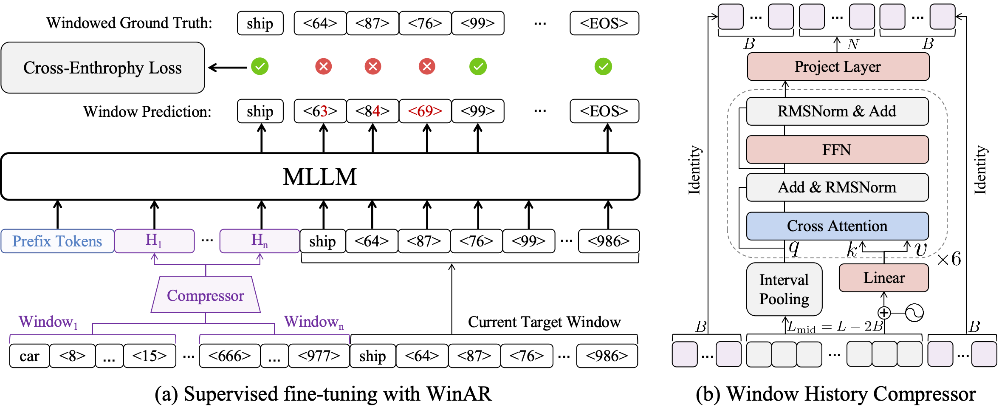
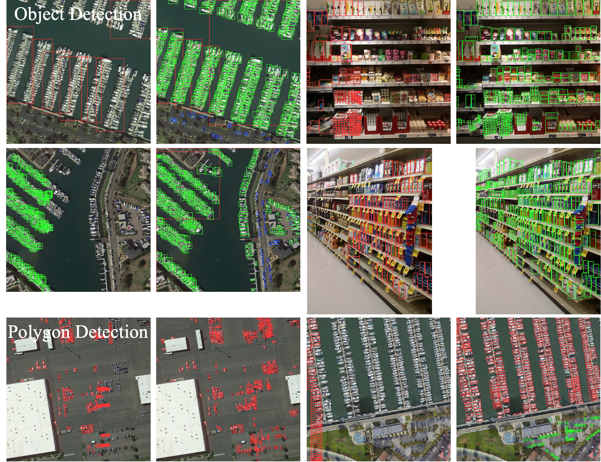

<h1 align="center">
  WinARDet<br>
  <sub><sup>Compressed Window Auto-Regression for Long-Horizon Vision-Language Grounding</sup></sub>
</h1>

<div align="center">

[](https://modelscope.cn/models/facias914/WinAR_Model)&#160;
[](https://huggingface.co/facias/WinARDet)&#160;
[](#)

</div>

## 🔍 Overview

MLLM-based detectors formulate vision-language grounding as autoregressive
coordinate generation. In dense scenes, however, full-history autoregression can
collapse into a **box repetition loop**: repeated coordinates dominate the growing
answer history, attract disproportionate attention, and exhaust the decoding budget
before all objects are discovered.

**WinARDet** introduces **Compressed Window Auto-Regression (WinAR)** for
long-horizon grounding. WinAR divides a long output sequence into consecutive
windows, preserves exact autoregression inside the current window, and compresses
each completed window into a fixed set of latent memory tokens. This design reduces
repeated exposure to historical coordinates while retaining the cross-window context
needed for coherent multi-object generation.

<p align="center">
  
</p>

## 🎀 Highlights

- **Substantially less redundancy and higher recall.** On RSDense, WinARDet reduces
  the mean prediction redundancy rate from **35.48% to 13.00%** and improves recall
  from **36.82 to 45.23** under the RexOmni implementation. 
- **Compatible with parallel decoding.** WinAR generalizes to the parallel box
  decoding framework of Locate Anything, demonstrating that it is not limited to
  token-by-token generation. 
- **Supports oriented boxes.** WinARDet extends beyond horizontal bounding boxes to
  quadrilateral representations for rotated-object detection. 
- **Much lower training memory.** WinAR reduces peak GPU memory by **25.4%** on
  RexOmni (57.62 GB → 42.97 GB) and by **34.1%** on Locate Anything
  (67.38 GB → 44.43 GB), enabling long-sequence training on 48 GB GPUs. 

<p align="center">
  
</p>

## 🍬 Environment Setup

```bash
git clone <WINARDET_REPOSITORY_URL> WinARDet
cd WinARDet

conda create -n winardet python=3.10 -y
conda activate winardet

python -m pip install --upgrade pip setuptools wheel ninja packaging

pip install torch==2.6.0 torchvision==0.21.0 \
  --index-url https://download.pytorch.org/whl/cu124

# Install the WinARDet package.
pip install -v -e .

# Install FlashAttention.
pip install flash-attn==2.7.4.post1
```

## 🍬 Dataset Setup

Download the released WinARDet datasets from the
[WinAR_Data repository on ModelScope](https://modelscope.cn/datasets/facias914/WinAR_Data).

```bash
pip install -U modelscope
modelscope download --dataset facias914/WinAR_Data \
  --local_dir ./WinAR_Data
```

The released collection is organized as follows:

```text
WinAR_Data/
├── train/
│   ├── DOTA2/
│   │   ├── images.tsv
│   │   ├── annotations.tsv
│   │   └── annotations.tsv.lineidx
│   ├── SODA-A/                  …
│   ├── SKU110K/                 …
│   ├── DOTA2_Poly/              …
│   └── SODA-A_Poly/             …
└── test/
    ├── DOTA2_SODA-A/
    │   ├── images/
    │   ├── annotations_rex.json
    │   └── annotations_coco.json
    ├── rs-dense200/             …
    ├── SKU110K/                 …
    ├── DOTA2_Poly/              …
    └── SODA-A_Poly/             …
```

Each training dataset uses three TSV files:

- `images.tsv` stores each image as a base64-encoded record.
- `annotations.tsv` stores one annotation JSON object per sample.
- `annotations.tsv.lineidx` stores the byte offset of each row in `annotations.tsv` for random access.

Each test dataset contains:

- `images/`, which stores the original image files;
- `annotations_rex.json`, which provides the RexOmni-format inference inputs;
- `annotations_coco.json`, which provides COCO-format ground-truth annotations
  for evaluation.

For converting a custom dataset into the required training or inference format,
refer to the data-preparation tools and documentation in the
[RexOmni repository](https://github.com/IDEA-Research/Rex-Omni).

## 🍬 Training

Refer to the [training guide](RexOmni_WinAR/finetuning/README.md) for environment setup, data
preparation, and WinARDet fine-tuning instructions.

## 🍬 Inference

Refer to the [inference and evaluation guide](RexOmni_WinAR/evaluation/README.md) for model
inference, prediction conversion, and benchmark evaluation.

## 🙏 Acknowledgements

We sincerely thank the authors of **RexOmni** and **Locate Anything** for their
excellent open-source work.

## 🌺 Citation

If you find WinARDet useful, please consider citing our paper:

```bibtex
@article{winardet2027,
  title   = {WinARDet: Compressed Window Auto-Regression for Long-Horizon Vision-Language Grounding},
  author  = {TBD},
  journal = {arXiv preprint arXiv:TBD},
  year    = {2027}
}
```
